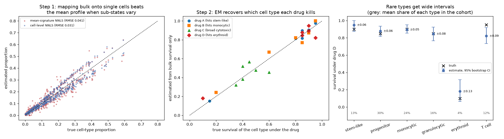

# Drug Sensitivity Deconvolution

> The patient's sample survived the drug at 60%. Which of its cell types died?

## Demo Output

Produced by `demo.py` from a simulated cohort of 80 AML-like patients. Each has bulk RNA, ex-vivo survival under four drugs, and there is one single-cell reference. Left: step 1, estimating composition. Middle: step 2, per-cell-type survival estimated from bulk survival alone. Right: how sure we can be for each cell type.

## Why This Exists

Ex-vivo drug screens such as beatAML measure one number per patient sample per drug: the fraction of cells still alive. But a leukaemia sample is a mixture of stem-like blasts, progenitors, monocytic cells, T cells and more. A drug that wipes out leukaemic stem cells can look useless if they are 5% of the sample.

Coudray et al. (*PLoS Comput Biol* 2026) proposed a two-step answer:
- **CLIMB** deconvolves bulk RNA into cell-type proportions by mapping each bulk sample onto individual reference *cells*, not cell-type averages.
- **CLIFF** treats each cell's survival as a hidden Bernoulli variable and uses EM to find the per-type survival that explains the bulk numbers across patients.

This repo implements both ideas in about 60 lines.

## How It Works

**Step 1: composition.** Solve `bulk ≈ Σ αᵢ · cellᵢ` with αᵢ ≥ 0 over every reference cell, then sum α by cell type. Mean-profile NNLS is included for comparison.

**Step 2: survival per type.** For each drug, survival is `yₙ = Σₖ wₙₖ · πₖ`. EM alternates two steps until πₖ stops changing:
- **E-step:** split each sample's survivors and deaths between cell types in proportion to `wₙₖ·πₖ` and `wₙₖ·(1−πₖ)`.
- **M-step:** set `πₖ` = survivors / (survivors + deaths), summed over patients.

**Bootstrap** over patients shows which πₖ the cohort can actually pin down.

## What the Demo Shows

| Finding | Number |
|---------|--------|
| Cell-level NNLS vs mean profile when sub-states vary | RMSE 0.031 vs 0.041 |
| Selective drugs (A, B, D): target cell type recovered | r ≥ 0.98 |
| Broad cytotoxic drug C: small differences between types | r ≈ 0.38, essentially unresolved |
| Erythroid cells (4.5% of cells): CI width under drug D | ±0.13, versus ±0.05 for monocytic cells (24%) |

## When NOT to Use This

- **Few patients or little variation in composition.** EM needs samples whose mixtures differ. With 10 patients that all look alike, the problem is unidentifiable.
- **Drugs that act on the mixture,** for example by killing via paracrine effects or by requiring cell-cell contact. The linear mixing assumption fails.
- **Cell types missing from the reference.** NNLS will hide them inside the nearest type, and their drug response goes with them.

## The Uncomfortable Truth

Per-cell-type sensitivity from bulk is a *statistical* estimate. It is not a measurement. Drug C shows that when cell types differ by 0.1 to 0.2 in survival, assay noise wins. Always report bootstrap intervals, and check any claim like "this drug targets stem cells" with sorted-cell or single-cell viability data before acting on it.

## Further Reading

- Coudray A. et al. "Computational deconvolution of drug sensitivity via single-cell-to-bulk transcriptome mapping." PLoS Computational Biology (2026). doi:10.1371/journal.pcbi.1014862
- Tyner J. W. et al. "Functional genomic landscape of acute myeloid leukaemia." Nature (2018).
- Avila Cobos F. et al. "Benchmarking of cell type deconvolution pipelines for transcriptomics data." Nature Communications (2020).
- Dempster A. P., Laird N. M. & Rubin D. B. "Maximum likelihood from incomplete data via the EM algorithm." JRSS-B (1977).
